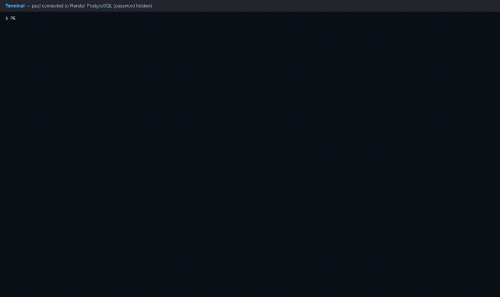

# WEB103 Project 3 - *UnityGrid Plaza*

Submitted by: **Anurag Bheemappa Gnanamurthy**

About this web app: **UnityGrid Plaza is a virtual community space for a futuristic city plaza. Users pick one of four venues by clicking its building on an illustrated plaza map: The Nebula Arcade, Spire Amphitheater, Verdant Commons, and Prism Dome Lab. Each venue has its own page listing every event held there, with live countdowns to upcoming events. An Events page shows everything happening across the plaza and can be filtered by location and sorted by date. The React front end loads all of its data from an Express API backed by a Render PostgreSQL database.**

Time spent: **X** hours

## Required Features

The following **required** functionality is completed:

<!-- Make sure to check off completed functionality below -->

- [x] **The web app uses React to display data from the API**
- [x] **The web app is connected to a PostgreSQL database, with an appropriately structured Events table**
  - [ ]  **NOTE: Your walkthrough added to the README must include a view of your Render dashboard demonstrating that your Postgres database is available**
  - [x]  **NOTE: Your walkthrough added to the README must include a demonstration of your table contents. Use the psql command 'SELECT * FROM tablename;' to display your table contents.**
- [x] **The web app displays a title.**
- [x] **Website includes a visual interface that allows users to select a location they would like to view.**
  - [x] *Note: A non-visual list of links to different locations is insufficient.* 
- [x] **Each location has a detail page with its own unique URL.**
- [x] **Clicking on a location navigates to its corresponding detail page and displays list of all events from the `events` table associated with that location.**

The following **optional** features are implemented:

- [x] An additional page shows all possible events
  - [x] Users can sort *or* filter events by location.
- [x] Events display a countdown showing the time remaining before that event
  - [x] Events appear with different formatting when the event has passed (ex. negative time, indication the event has passed, crossed out, etc.).

The following **additional** features are implemented:

- [x] The plaza map is data-driven: each location's clickable outline (`map_points`) is stored in the `locations` table and rendered as an SVG polygon, with a hover/focus label
- [x] The map is keyboard accessible (Tab to a building, Enter to open it), and venue cards below the map provide a second way in on small screens
- [x] The Events page supports filtering by location, sorting by date (soonest or latest first), and hiding past events; the filters are stored in the URL so a filtered view can be shared
- [x] Countdowns tick every second; venue pages split events into "Upcoming" and "Past" and move events across automatically when they start
- [x] Past events are greyed out, crossed out, and labelled "Event ended N days ago"
- [x] Unknown locations and routes show a 404 page; the API returns proper 400/404 JSON errors
- [x] Seed data is relative to the reset time, so `npm run reset` always produces a mix of past and upcoming events
- [x] Responsive layout from phone to desktop, plus an automated test suite (`tools/e2e_test.py`, 33 checks)

## Video Walkthrough

Here's a walkthrough of implemented required features:



<!-- Replace this with whatever GIF tool you used! -->
GIF created with a scripted Playwright recording converted with ffmpeg (`tools/record_walkthrough.py`)
<!-- Recommended tools:
[Kap](https://getkap.co/) for macOS
[ScreenToGif](https://www.screentogif.com/) for Windows
[peek](https://github.com/phw/peek) for Linux. -->

## Notes

Built from the CodePath starter: React 18 + Vite, React Router, Picocss, and an Express + `pg` API.

**Database schema**

```sql
CREATE TABLE locations (
    id          SERIAL PRIMARY KEY,
    slug        VARCHAR(60)  NOT NULL UNIQUE,
    name        VARCHAR(100) NOT NULL,
    tagline     VARCHAR(200) NOT NULL,
    description TEXT         NOT NULL,
    address     VARCHAR(150) NOT NULL,
    city        VARCHAR(80)  NOT NULL,
    state       CHAR(2)      NOT NULL,
    zip         VARCHAR(10)  NOT NULL,
    image       TEXT         NOT NULL,
    map_points  TEXT         NOT NULL
);

CREATE TABLE events (
    id          SERIAL PRIMARY KEY,
    location_id INTEGER      NOT NULL REFERENCES locations(id) ON DELETE CASCADE,
    title       VARCHAR(150) NOT NULL,
    description TEXT         NOT NULL,
    category    VARCHAR(50)  NOT NULL,
    starts_at   TIMESTAMPTZ  NOT NULL,
    image       TEXT         NOT NULL
);
CREATE INDEX events_location_id_starts_at_idx ON events (location_id, starts_at);
```

**API**

| Route | Returns |
|---|---|
| `GET /api/locations` | All locations |
| `GET /api/locations/:slug` | One location |
| `GET /api/locations/:slug/events` | Events at that location |
| `GET /api/events?location=&sort=asc\|desc` | All events, optionally filtered by location and sorted by date |
| `GET /api/events/:id` | One event |

**Running locally**

1. Copy `server/.env.example` to `server/.env` and fill in the values from the **Connections** section of your Render Postgres database.
2. `npm install`
3. `npm run reset` creates the `locations` and `events` tables and seeds them.
4. `npm run dev` starts the app at http://localhost:5173, with the API on the `PORT` set in `server/.env`.
   - Production build: `npm run build && npm start`, then open `http://localhost:<PORT>`.

**Testing and recording** (optional; the Python tooling lives in a local venv)

```bash
python3 -m venv .venv
.venv/bin/pip install -r tools/requirements.txt
.venv/bin/playwright install chromium
.venv/bin/python tools/e2e_test.py            # 33 API + browser checks (app must be running on port 3002)
.venv/bin/python tools/record_walkthrough.py  # regenerates docs/walkthrough.gif (needs Docker for psql)
```

Event photos are from [Unsplash](https://unsplash.com). The plaza illustration and venue images come from the starter's `unitygrid.jpg`.

## License

Copyright 2026 Anurag Bheemappa Gnanamurthy

Licensed under the Apache License, Version 2.0 (the "License"); you may not use this file except in compliance with the License. You may obtain a copy of the License at

> http://www.apache.org/licenses/LICENSE-2.0

Unless required by applicable law or agreed to in writing, software distributed under the License is distributed on an "AS IS" BASIS, WITHOUT WARRANTIES OR CONDITIONS OF ANY KIND, either express or implied. See the License for the specific language governing permissions and limitations under the License.
